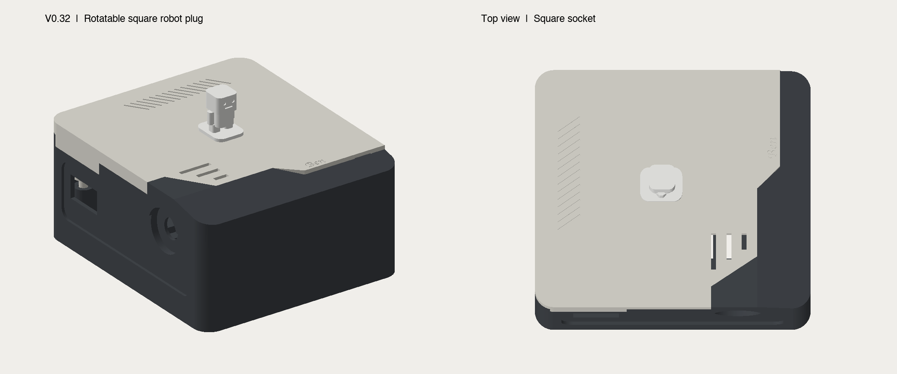
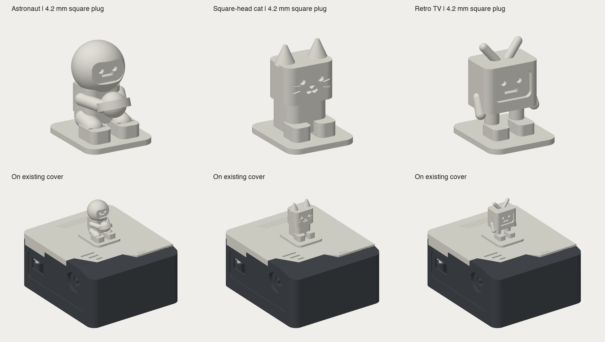

# SIM7600 iMessage Gateway — enclosure and figurines

A three-piece desktop enclosure for the **Waveshare SIM7600X 4G HAT fitted with a SIM7600CE-T module**, plus interchangeable decorative figurines. It houses the USB-connected SMS gateway described in [SMS-iMessage-Gateway](https://github.com/Yu-Ren-NEU/SMS-iMessage-Gateway). The software forwards SIM-card SMS to iMessage and accepts iMessage commands to send SMS. This directory contains the printable hardware, not the forwarding software.

## What to print

| Directory | Contents |
|---|---|
| [enclosure](enclosure/) | Final V0.32 base, lid carrier and top cover; STL, STEP, parameters, CadQuery source and assembly preview |
| [plugins](plugins/) | Original small robot; larger astronaut, square-headed cat and retro TV; printable STL and previews |

Print one each of `base.stl`, `lid-carrier.stl` and `top-cover.stl`. Suggested colors are black for the base/carrier and limestone white for the cover. PETG was chosen for the working enclosure. STEP, Python, JSON and PNG files do not need printing. Import STLs in **millimeters**.

The enclosure provides module USB and antenna access, a combined side service opening, vent slots, PCB support posts, and a square socket for a removable figurine. The original robot is small; the astronaut/cat/TV have roughly twice its dimensions along each axis. Figurines can be inserted in four orientations.

## Fit and printing status

The owner confirmed the final enclosure's physical assembly is excellent. The lid socket is 4.4 × 4.4 mm. The original robot's 4.0 mm peg was loose; replacement figurines use 4.2 × 4.2 mm pegs, 1.65 mm insertion depth and a 0.25 mm lead-in chamfer. The first larger replacement prints did not fit; the cause remains unconfirmed and a reprint is planned. A private Dou adaptation has not been printed and is excluded from this public package. Do not force insertion.

Ask the shop to review supports and orientation, preserve plug dimensions, and record slicer settings and weight. Printing tolerances can affect fit. Check the specific PCB revision and ports against [enclosure notes](enclosure/README.md) before adapting this design for other hardware. CAD regeneration requires CadQuery and the font referenced by the engraving source; Apple fonts are not redistributed.

## Attribution and licensing

Original enclosure and robot/astronaut/cat/TV designs are from the SMS-iMessage-Gateway project and retain its [MIT license](LICENSE). **Dou is excluded from this package**: the owner supplied a license screenshot identifying its source sculpt as [CC BY-NC-ND 4.0](https://creativecommons.org/licenses/by-nc-nd/4.0/), which does not permit distribution of the modified model. Separate rights-holder permission is required before publishing the adaptation.
