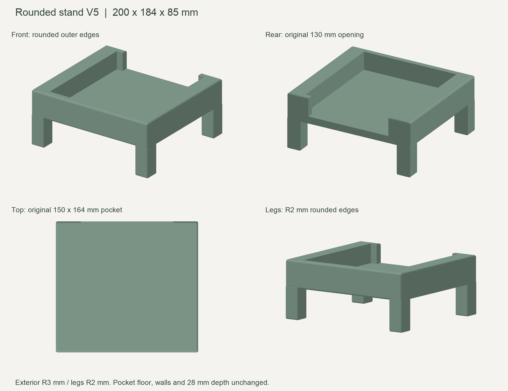

# TIMEMORE FISH SMART Kettle Stand

A raised, one-piece stand for the temperature-control base of the **TIMEMORE FISH SMART coffee kettle**. The base sits inside a recessed pocket with its top flush with the surrounding platforms. The space underneath can hold a coffee scale that fits the available clearance.

## Files

- [stand.stl](stand.stl): the printable, rounded model (V5). Import with millimeters as the unit.
- [preview.png](preview.png): four views rendered from the exported STL.

## Design

The left and right platforms are wider than the front platform. Two short walls extend inward from the rear corners to keep the kettle base from sliding out backward, while the middle stays open for the power cable. The base is inserted from above.

The exterior has 3 mm radius fillets, and the leg edges have 2 mm radius fillets. The pocket's inner walls and floor retain their sharp geometry and original dimensions.

| Feature | Dimension |
| --- | --- |
| Overall width × depth × height | 200 × 184 × 85 mm |
| Measured kettle base width × depth × height | 148 × 162 × 28 mm |
| Pocket width × depth × recess depth | 150 × 164 × 28 mm |
| Nominal lateral clearance | 1 mm per side with the base centered |
| Left and right platform width | 25 mm each |
| Front platform width | 10 mm |
| Rear wall inward extension | 10 mm on each side |
| Rear center opening width | 130 mm |
| Deck thickness beneath the pocket | 12 mm |
| Clear height beneath the deck | 45 mm |
| Front opening between the legs | 156 mm |

The overall model fits within a 325 × 320 × 325 mm build volume and is designed as one connected piece. Printing orientation and supports still need to be determined in the slicer.

## Validation status

The exported STL has been checked to be watertight, consistently oriented, and a single connected component. Its outer dimensions have been verified, and the locating pocket was checked for interference after adding the exterior fillets.

This version has **not yet been physically printed or test-fitted**. Confirm the actual base, feet, cable routing, and scale dimensions before printing. The rear walls provide positional restraint; they are not a snap-fit latch.
